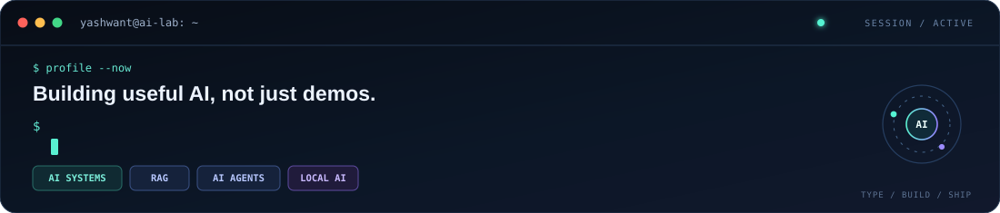
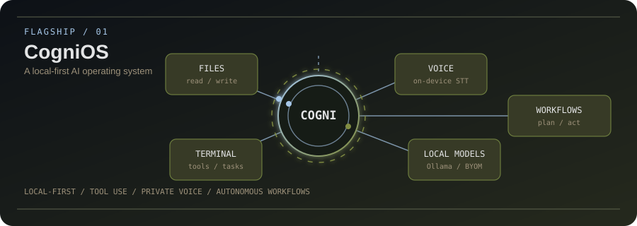
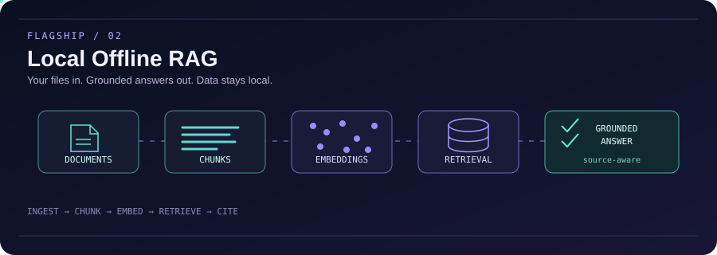
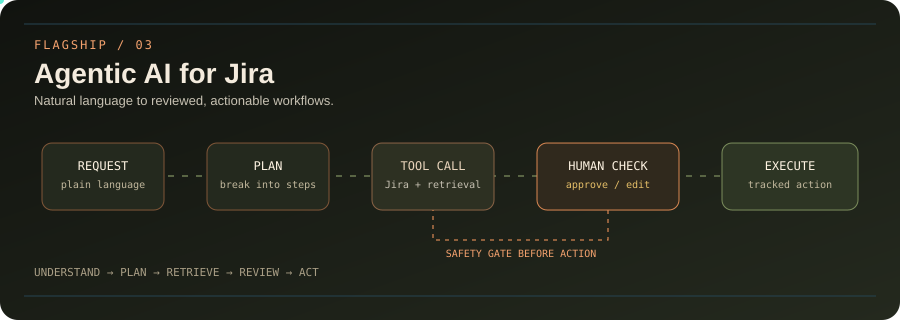
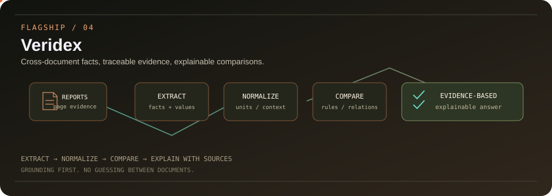

<div align="center">





<div align="center">

<a href="https://yashwant-kumar-chitchula.vercel.app/"></a>&nbsp;
<a href="https://linkedin.com/in/yashwant-kumar-chitchula-117131290"></a>&nbsp;
<a href="mailto:chyk2468@gmail.com"></a><br/>
<a href="https://bsky.app/profile/chyk2468.bsky.social"></a>&nbsp;
<a href="https://github.com/chyk2468"></a>

</div>

<sub>B.Tech CSE (AI & ML) · Software Engineering · Local-first AI Systems</sub>

</div>

---

## 01 / Flagship Systems in Motion

<table>
<tr>
<td width="50%" valign="top">

<a href="https://github.com/chyk2468/CogniOS">
  
</a>

### 🧠 [CogniOS](https://github.com/chyk2468/CogniOS)
Local-first AI desktop operating system connecting files, native OS tools, local models via Ollama, and autonomous multi-agent workflows.

</td>
<td width="50%" valign="top">

<a href="https://github.com/chyk2468/Local-Offline-RAG-System">
  
</a>

### 📚 [Local Offline RAG System](https://github.com/chyk2468/RAG-File-Search)
Private, air-gapped document intelligence and semantic search powered by local vector embeddings and local LLMs.

</td>
</tr>
<tr>
<td width="50%" valign="top">

<a href="https://github.com/chyk2468/Agentic-AI-JIRA">
  
</a>

### ⚡ [Agentic AI for Jira](https://github.com/chyk2468/Agentic-AI-JIRA)
Natural-language Jira orchestration with Chroma issue retrieval, structured JSON action planning, and human-in-the-loop approval.

</td>
<td width="50%" valign="top">

<a href="https://github.com/chyk2468/Veridex">
  
</a>

### 🔍 [Veridex](https://github.com/chyk2468/Veridex)
Explainable cross-document fact intelligence platform with page-level evidence citation and deterministic claim contradiction detection.

</td>
</tr>
</table>

---

## 02 / Specialized Engineering Builds

<table>
<tr>
<td width="50%" valign="top">

### 🫀 [ECG PatchTST + XAI](https://github.com/chyk2468/ecg-patchtst-xai)
Time-series Patch Transformer for 12-lead ECG arrhythmia classification featuring multi-method explainability (SHAP, Grad-CAM, Integrated Gradients).

</td>
<td width="50%" valign="top">

### 🏢 [Homely](https://github.com/chyk2468/Homely)
Intelligent residential operations and facility maintenance platform with FastAPI, React, SQLite/PostgreSQL, and role-based access.

</td>
</tr>
<tr>
<td width="50%" valign="top">

### 🪖 [Smart Industrial Helmet](https://github.com/chyk2468/Smart-Helmet-for-industrial-safety-monitoring-using-esp32-and-Blynk.)
IoT industrial worker safety helmet utilizing ESP32-S3, MPU9250 motion/fall detection, MQ-2 combustible gas sensor, and real-time Blynk telemetry.

</td>
<td width="50%" valign="top">

### ✉️ [MailMind AI](https://github.com/chyk2468/MailMind-AI)
Tone-controlled email reply generation platform grounded in local Chroma example embeddings and Google Gemini 2.0 Flash.

</td>
</tr>
<tr>
<td width="50%" valign="top">

### 🚦 [AI Traffic Monitor](https://github.com/chyk2468/Traffic-Monitor)
Computer vision traffic surveillance pipeline with YOLOv8, DeepSORT multi-object tracking, and multi-lane flow density analytics.

</td>
<td width="50%" valign="top">

### 🔎 [Semantic Search Engine](https://github.com/chyk2468/Semantic-Search-Engine)
High-performance dense vector retrieval system with sentence transformers, FAISS/Chroma indexing, and sub-10ms query latency.

</td>
</tr>
</table>

---

## 03 / Core Competencies & Architecture Focus

```text
AI & Machine Learning    : Local-First RAG, Multi-Agent Systems, LangChain, PyTorch, Transformers, Computer Vision (YOLO)
Backend & Cloud Systems  : FastAPI, Python, Node.js/Express, RESTful APIs, SQLite, PostgreSQL, ChromaDB, Docker
Frontend & Interface    : React, TypeScript, Next.js, Vite, Tailwind CSS, Streamlit
Hardware & IoT           : ESP32-S3, Arduino C++, I2C/SPI Sensor Interfacing, Blynk IoT Cloud, Optical QR Protocols
```

---

<p align="center">
  <sub>Portfolio maintained with engineering rigor · Open to software engineering & AI systems opportunities</sub><br/>
  <a href="https://yashwant-kumar-chitchula.vercel.app/"><strong>Visit Interactive Portfolio Website →</strong></a>
</p>
